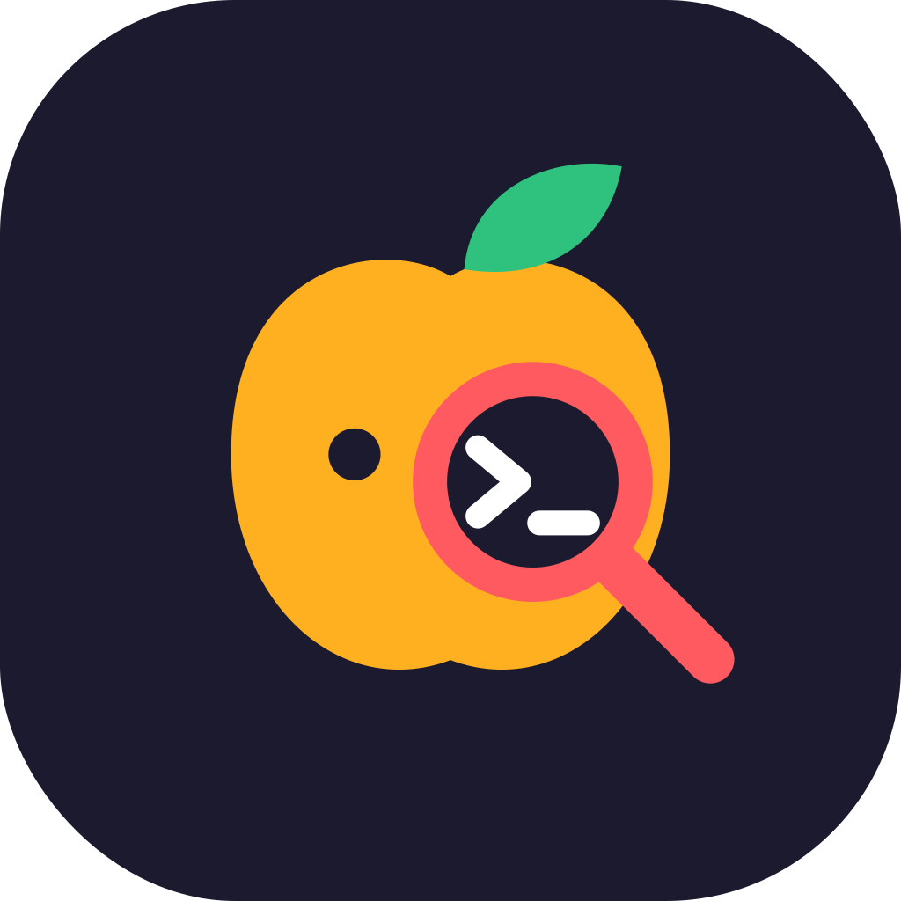

<p align="center">
  
</p>

<p align="center">
  <a href="docs/README.md">Docs</a>
  ·
  <a href="template/">Template</a>
  ·
  <a href="skills/">Skills</a>
  ·
  <a href="modules/">Modules</a>
</p>

<p align="center">
  <a href="LICENSE"></a>
</p>

# Ledgibly

With the widespread adoption of coding assistants, developers are spending less time reviewing code and more time ideating and creating new and better programs.

This has completely changed the way of coding, and new problems have arisen: programmers have very low visibility on the code details, agents perform extensive code reviews by consuming tokens before working on a new request; when a conversation chat is closed and a new one opened, the previous context is lost and everything starts from zero; developers have to keep in mind architectural decisions, backlog, and current status. Skills and memory layers partially solve these problems, but still don't make coding agents a reliable partner to tackle complex projects.

**Ledgibly** tries to solve it by adding a layer between developers and an agent harness. The setup is very simple, as the name suggests, it makes a repository legible by using a ledger: one task table (`implementation_ledger.md`) is the only place status is asserted, with evidence and a newest-first UTC log. `plan.md` is the scope. `docs/` tracks how the system works. The README is install and run. Per-repo facts live in one `AGENTS.md` section so the skills stay generic. At the moment the kit is specialized for Cursor.

# So, what can I do with this software?

* Start a new repo that already has a plan, a ledger, docs, an agent profile, and a checker.
* Give work a stable ID **before** anyone writes code. Cursor plan todos become rows first.
* Require evidence for `done`: paths plus commands that passed. Status is not restated in docs or the README.
* Install the same three skills (`keep-implementation-ledger`, `code-review`, `figma-ui`) into every machine you use for this work.

## Motivations

* Status copied into several files drifts. One table does not.
* A row plus a command that passed is easier to trust than a paragraph that says "done".
* Agents read one row and the recent log, not the whole history. That is how they keep track of work so far, spend fewer tokens, and stop reviewing the full codebase to understand what to do.
* The coding assistant becomes then also the product owner of the use case: the ledger is the development diary of the work.
* The next project should start from [`template/`](template/), not from this repository's BP / DOC / QA rows.

# How to use this project?

This is a working template for the main case: Cursor, one ledger, a few skills. It does not try to cover every editor. If you have a coding agent, use it as the interface: the skills say when to add a row; `scripts/ledger_check.py` says when the table is wrong. Optional modules (`figma`, `source-docs`, `python-uv`, `formatter`, `database-design`, `rtk`) are overlays, not the default.

## Start here

```sh
uv tool install ledgibly
# pipx install ledgibly
ledgibly install-skills
```

After a kit upgrade, re-run `ledgibly install-skills` so copied skills pick up changes.

Then bootstrap a new repo:

```sh
ledgibly init /path/to/new-repo \
  --name MyApp \
  --prefixes "ART FE BE DOC QA" \
  --verify "cd frontend && npm test" \
  --with figma,source-docs,python-uv,formatter,database-design,rtk
```

`--with` is optional. `ledgibly init` refuses to overwrite existing files. It copies `template/`, overlays modules, and replaces `{{PROJECT}}` / `{{PREFIXES}}` / `{{VERIFY}}` / `{{DATE}}` only in those copied files. It creates `.cursor/skills -> ../.agents/skills`, and prints remaining `<fill me>` lines. Seed rows use `ART-`; if `--prefixes` omits `ART`, init prepends it. The target gets a copied stdlib `scripts/ledger_check.py` and does not depend on the `ledgibly` package at runtime.

Fill the Agent profile (docs map, pre-checks, Review trace), then start from the first `pending` row.

### From source (kit development)

```sh
git clone https://github.com/FedeMatt/ledgibly.git
cd ledgibly
cargo run -- install-skills
cargo run -- init /path/to/new-repo --name MyApp
```

## Document roles

Four files, four jobs. The ledger is the only status source.

| File | Job | Change when |
|---|---|---|
| `plan.md` | Scope and architecture | Scope or architecture changes, with user agreement |
| `implementation_ledger.md` | Task table + UTC log | Every task start/finish |
| `docs/` | How the system works. Cite task IDs; never restate status | Behavior or structure changes |
| `README.md` | Install and run | Those steps change |

Skills read **only** the `## Agent profile` section of `AGENTS.md` for per-repo facts.

| Skill | When |
|---|---|
| `keep-implementation-ledger` | Starting or finishing a task, choosing the next task, recording evidence |
| `code-review` | Auditing a change; driven by the profile `Review` block |
| `figma-ui` | Implementing a named Figma frame; driven by the profile `Figma` block |

Repo-local skills (python-uv, source-docs, database-design) land in the target's `.agents/skills/` when you pass `--with`.

## What a new repo gets

```
AGENTS.md                         Agent profile (Ledger + Review)
plan.md                           Product, architecture, policy, out of scope
implementation_ledger.md          Tasks table, environment evidence, milestones, UTC log
implementation_ledger_archive.md  Verbatim overflow
README.md                         Install and run
docs/README.md                    Chapter index
docs/01-architecture.md           First chapter
.cursor/rules/ponytail.mdc        Lazy-senior-dev ladder
.agents/skills/                   Project skills (modules add more)
.cursor/skills -> ../.agents/skills
scripts/ledger_check.py           Structural checks
```

Numbered docs chapters use `[Index](README.md) · [ledger](...)`. Cite IDs inline. Do **not** keep a `Tasks:` header list or a coverage table; `rg -l '<ID>' docs/` and the checker cover that.

Statuses, cell budgets, and `ledger_check.py` errors and warnings: [docs/01-framework.md](docs/01-framework.md).

```sh
python3 scripts/ledger_check.py
```

## Development of this kit

```sh
cargo test
bash tests/selftest.sh
python3 template/scripts/ledger_check.py
```

Status: [`implementation_ledger.md`](implementation_ledger.md). Scope: [`plan.md`](plan.md).
